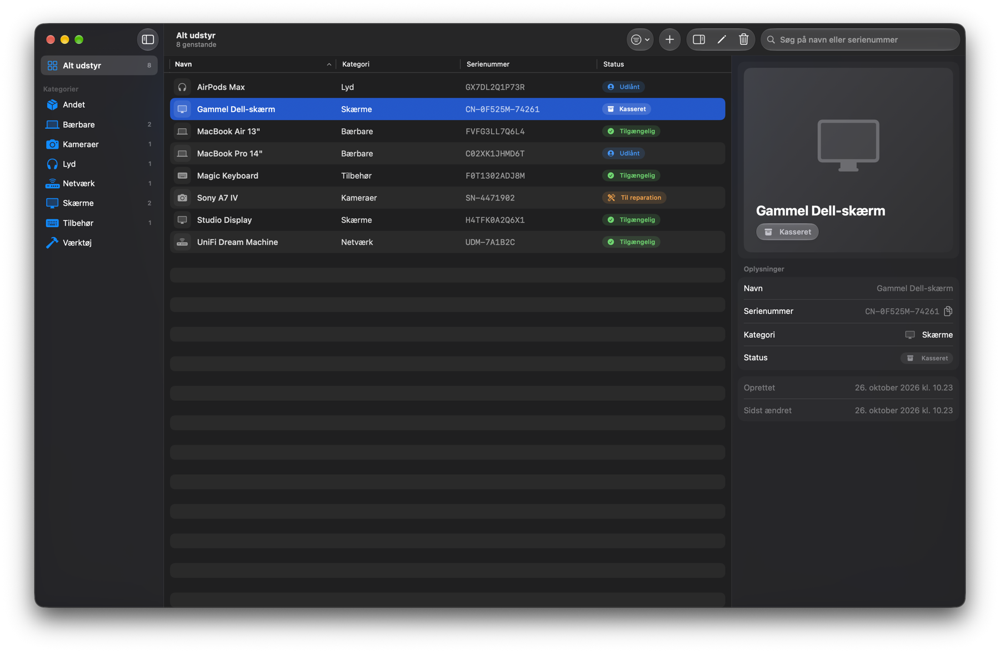
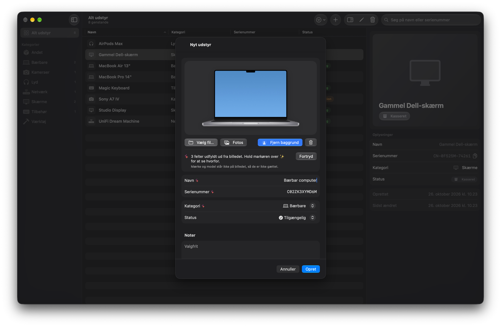
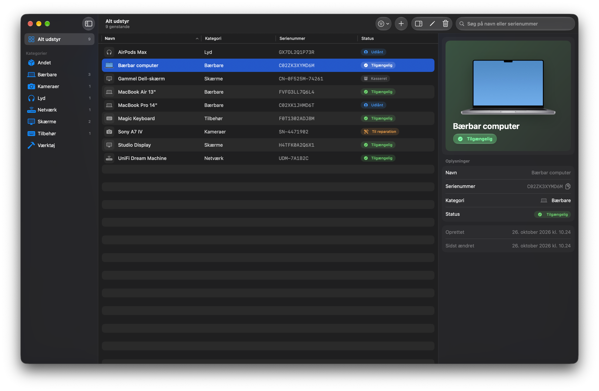

<div align="center">


# Inventar

**Hold styr på udstyret – smukt, hurtigt og helt på din Mac.**

Et Mac-native inventarsystem bygget med SwiftUI, SwiftData og Liquid Glass.<br />
Tag et billede af udstyret, og Apple Intelligence fjerner baggrunden og udfylder formularen – uden at gætte.




</div>

## Funktioner

- **Overblik på et øjeblik** – al udstyr i én tabel med navn, kategori, serienummer og status. Sortér på kolonnerne, og se antal pr. kategori i sidepanelet.
- **Detaljepanel** – vælg en genstand og se billede, status og alle oplysninger i inspektøren til højre. Kopiér serienummeret med ét klik.
- **Opret, redigér og slet** – med validering af navn og serienummer, og bekræftelse før noget slettes.
- **Søg og filtrér** – søg på navn eller serienummer (⌘F), filtrér på kategori i sidepanelet og på status i værktøjslinjen.
- **Billeder, som du vil** – træk og slip, indsæt, vælg en fil, hent fra Fotos eller tag et billede med din iPhone via Kontinuitetskamera.
- **Automatisk fritlægning** – Vision fjerner baggrunden, når det giver mening, så genstanden står skarpt. Du kan altid skifte tilbage til originalen.
- **Liquid Glass** – sidepanel, værktøjslinje, knapper og statusmærker bruger det nye glasdesign i macOS.
- **Føles som en Mac-app** – menukommandoer, tastaturgenveje, højreklikmenuer, dobbeltklik for at redigere og ⌫ for at slette.

## Apple Intelligence, der ikke gætter



Når du tilføjer et billede, læser Inventar det med Vision og Apples sprogmodel – alt sammen lokalt på din Mac. Formularen bliver kun udfyldt med det, billedet faktisk viser:

| Felt | Hvordan det udfyldes |
| --- | --- |
| **Navn** | Mærke og model, hvis de står som tekst på genstanden. Ellers kun genstandstypen, f.eks. "Bærbar computer". |
| **Serienummer** | Kun hvis det kan læses på billedet. Tal ved "S/N", "Serial No." og "Serienummer" læses direkte, og modelnumre, IMEI og lignende bliver aldrig brugt som serienummer. |
| **Kategori** | Vælges blandt dine egne kategorier – og kun når genstanden er genkendt sikkert. |
| **Noter** | Anden tekst, der står på genstanden. Farve og stand bliver ikke gættet. |

Viser billedet flere genstande eller ingen tydelig genstand, bliver intet udfyldt. Felter, du selv har skrevet i, bliver aldrig overskrevet. Hvert udfyldt felt er markeret med ✨ og en kort forklaring af, hvor værdien kommer fra, og **Fortryd** fjerner alle forslag igen.



## Krav

| Krav | Sådan løses det |
| --- | --- |
| **1 – Vis udstyr** | Tabel med navn, kategori, serienummer og status. |
| **2 – Opret udstyr** | "Nyt udstyr" (⌘N) åbner en formular. Navn og serienummer må ikke være tomme. |
| **3 – Vis detaljer** | Det valgte element vises i detaljepanelet til højre. |
| **4 – Rediger og slet** | Redigér fra værktøjslinjen, højreklikmenuen eller med dobbeltklik. Sletning kræver bekræftelse. |
| **5 – Søg og filtrér** | Søg på navn eller serienummer, filtrér på kategori og status. |

## Kom i gang

**Krav:** macOS 27 og Xcode 27. Automatisk udfyldning kræver en Mac med Apple Intelligence slået til – resten af appen virker uden.

1. Klon projektet og åbn `InventarApplication.xcodeproj` i Xcode.
2. Vælg skemaet **InventarApplication** og tryk **⌘R**.

Vil du prøve appen med eksempeldata, så tilføj `-UseSampleData` under *Product ▸ Scheme ▸ Edit Scheme… ▸ Run ▸ Arguments*. Så starter Inventar med otte eksempler i en midlertidig database, der nulstilles, når appen lukkes.

### Tastaturgenveje

| Genvej | Handling |
| --- | --- |
| ⌘N | Nyt udstyr |
| ⌘F | Søg |
| ⌫ | Slet det valgte udstyr |
| Dobbeltklik | Redigér det valgte udstyr |
| Return / Esc | Opret eller gem / annullér i formularen |

## Sådan er det bygget

- **SwiftData** gemmer udstyr og kategorier med et versioneret skema. Billeder gemmes uden for databasen, og tabellen bruger små miniaturer.
- **Vision** fritlægger motivet (`GenerateForegroundInstanceMaskRequest`) og læser tekst (`RecognizeTextRequest`).
- **Foundation Models** ser på billedet og svarer i et fast skema, hvor genstandstype og kategori vælges fra lister. Svarene tjekkes bagefter mod teksten på billedet.
- **SwiftUI** med `NavigationSplitView`, `Table`, `.inspector` og Liquid Glass (`glassEffect`, `.glass`-knapper).

```
InventarApplication/
├── App/            App-indgang og menukommandoer
├── Models/         Equipment, EquipmentCategory, EquipmentStatus, EquipmentDraft
├── Persistence/    SwiftData-skema, container og eksempeldata
├── Images/         Nedskalering, fritlægning og miniaturer
├── Intelligence/   Automatisk udfyldning og tjek af tekst på billedet
└── Views/          Sidepanel, tabel, detaljepanel, formular og komponenter
```

## Privatliv

Alt foregår på din Mac. Billeder, tekstgenkendelse og sprogmodel kører lokalt – intet sendes til en server.
